# Microsoft 365 & Azure Help Desk Administration Lab

## Project Overview

This project demonstrates hands-on experience administering a simulated corporate Microsoft 365 environment for NovaTech Solutions.

I configured Microsoft Entra ID, Exchange Online, Microsoft Intune, and Microsoft 365 administrative services to practice common Tier 1 and Tier 2 IT support responsibilities.

The lab includes user provisioning, license management, security groups, MFA policy configuration, shared mailbox administration, device enrollment, compliance troubleshooting, password resets, and employee onboarding/offboarding.

**Environment:** Microsoft 365 Business Premium Trial  
**Organization:** NovaTech Solutions  
**Tenant:** `novatechhelpdesk.onmicrosoft.com`  
**Device:** Windows 11 Pro on Oracle VirtualBox

## Technologies Used

- Microsoft 365 Admin Center
- Microsoft Entra ID (Azure Active Directory)
- Microsoft Exchange Online
- Microsoft Intune
- Microsoft Defender Antivirus
- Conditional Access
- Microsoft Authenticator
- Windows 11 Pro
- Oracle VirtualBox

## 1. Microsoft 365 Tenant and User Administration

Configured a Microsoft 365 Business Premium tenant and provisioned eight fictional employee accounts across IT, Human Resources, Finance, and Sales.

Assigned Microsoft 365 licenses and maintained standard user permissions.

### Microsoft 365 Admin Dashboard

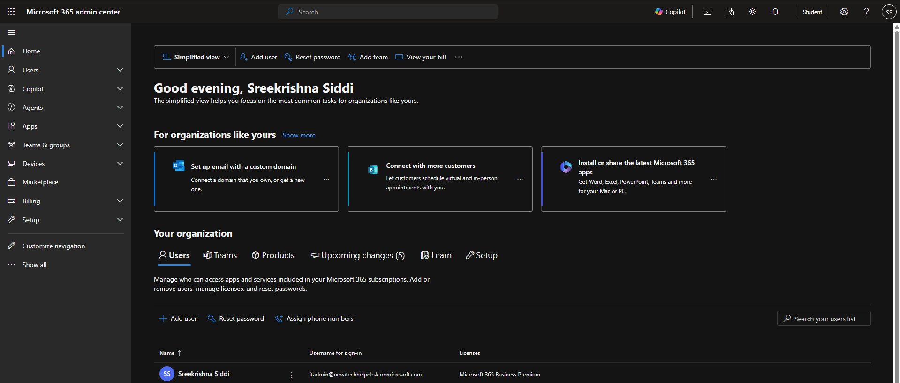

### User Creation

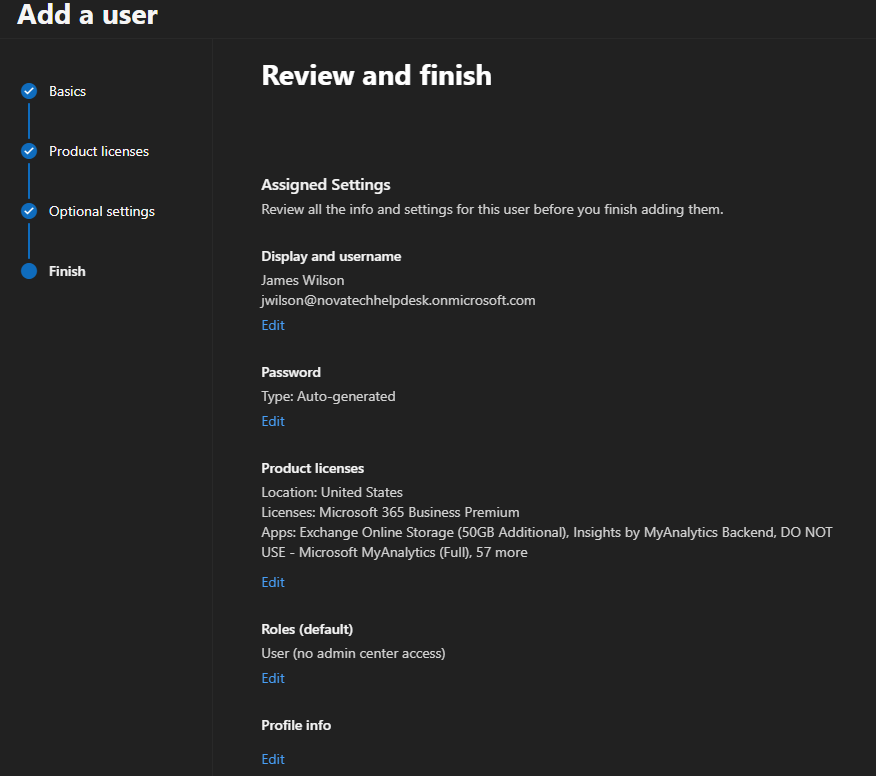

### Active Users

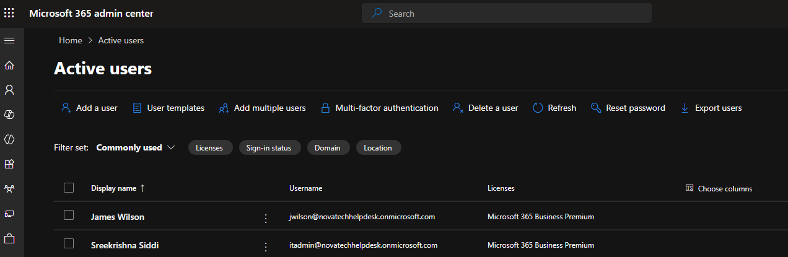

### Department Employees

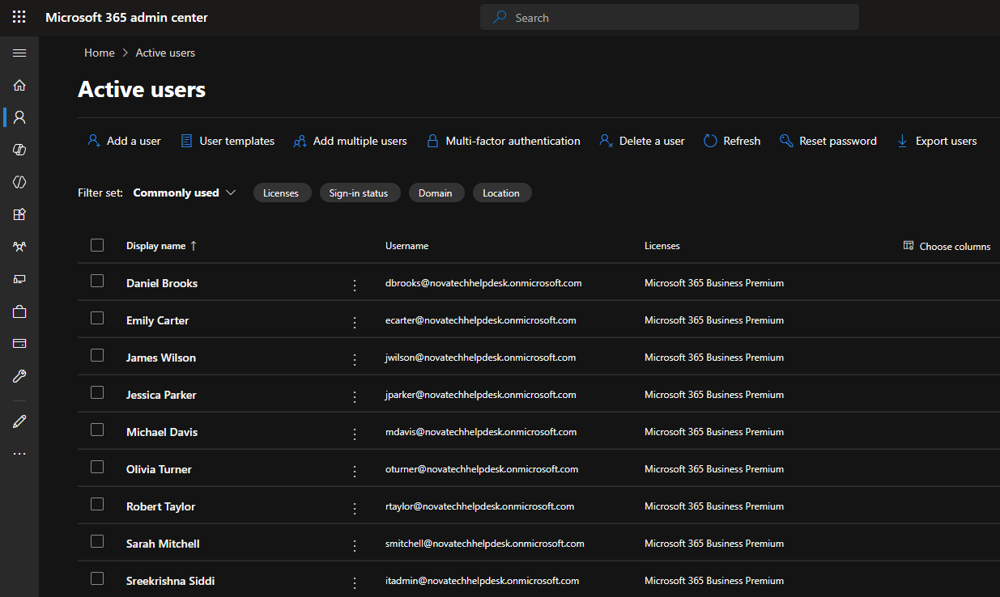

## 2. Microsoft Entra ID — Identity and Access Management

Created departmental security groups and configured assigned membership to organize user access.

**Security Groups:**
- SG-IT-Staff
- SG-HR-Staff
- SG-Finance-Staff
- SG-Sales-Staff

### Microsoft Entra Dashboard

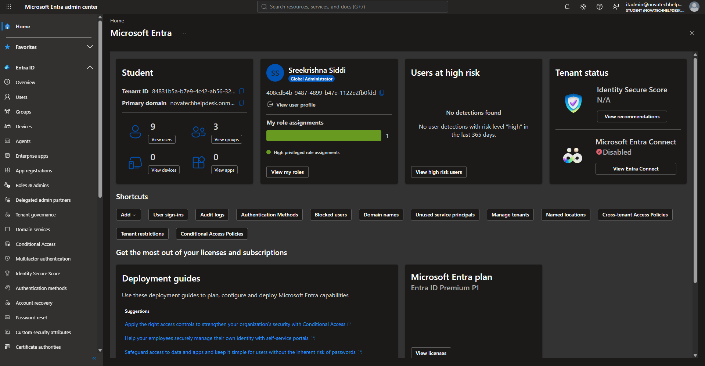

### Security Groups

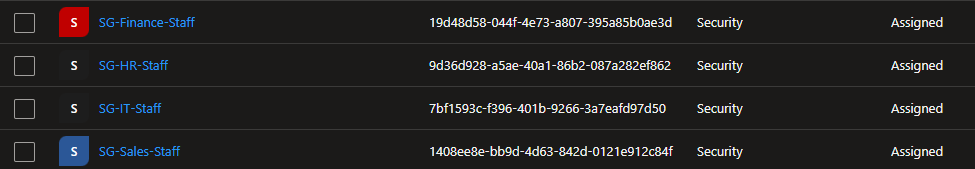

### Group Membership

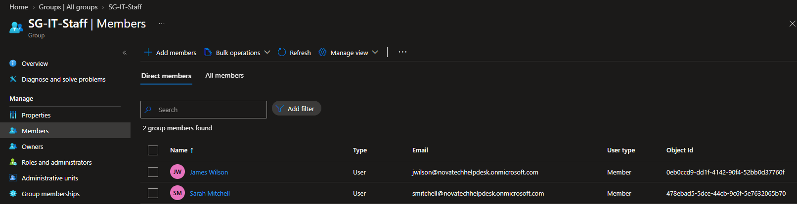

## 3. Multi-Factor Authentication and Conditional Access

Configured Microsoft Authenticator as an authentication method for IT employees.

Created a Conditional Access policy targeting the IT security group.

**Policy Configuration:**
- Policy: `CA-Require-MFA-IT-Users`
- Target: SG-IT-Staff
- Resources: All resources
- Grant control: Require multifactor authentication
- Policy state: Report-only

The policy was evaluated in Report-only mode without enforcing MFA through that policy.

### Authentication Methods

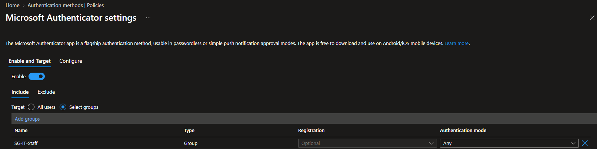

### Conditional Access Policy

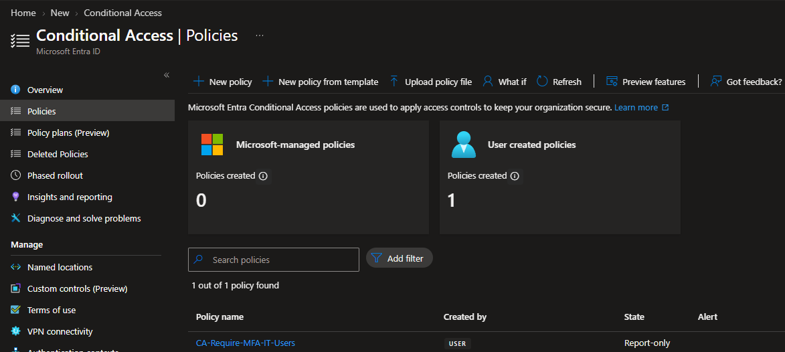

### Conditional Access Configuration

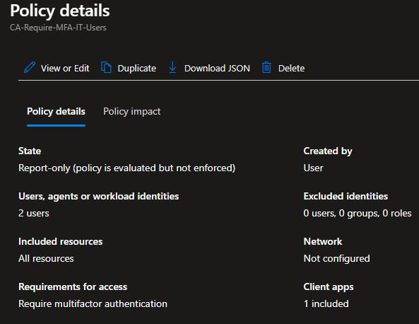

## 4. Exchange Online Administration

Created an IT Support shared mailbox and configured delegated access for department employees.

**Shared Mailbox:** `support@novatechhelpdesk.onmicrosoft.com`

Configured:
- Full Access permissions
- Send As permissions
- Departmental email distribution list
- Internal distribution group membership

### Shared Mailbox

### Full Access Permissions

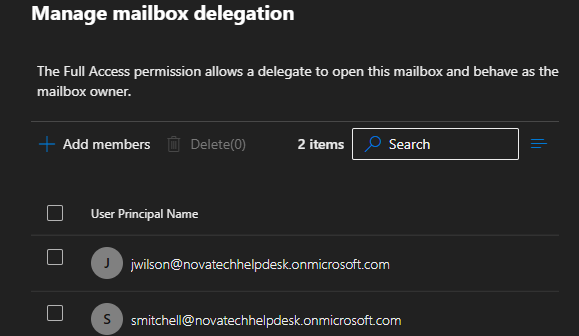

### Send As Permissions

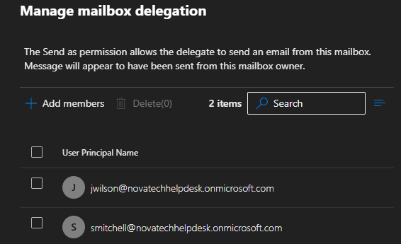

### Distribution List

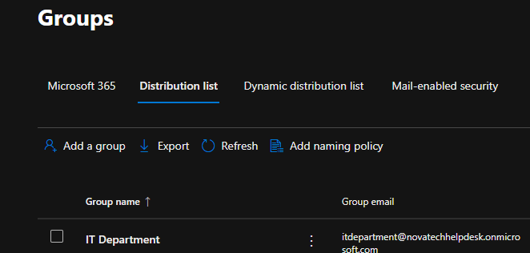

### Distribution List Members

### Email Delivery Testing

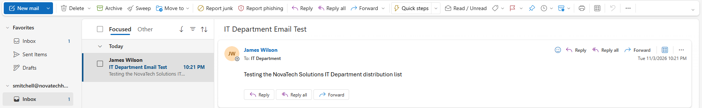

## 5. Microsoft Intune Device Management

Configured automatic MDM enrollment for an assigned Microsoft Entra security group.

Created a Windows 11 Pro virtual machine and joined it to Microsoft Entra ID.

Verified that the workstation was successfully managed through Microsoft Intune.

**Device Name:** `M365-WIN01`  
**Operating System:** Windows 11 Pro  
**Primary User:** James Wilson  
**Management Platform:** Microsoft Intune

### Intune Dashboard

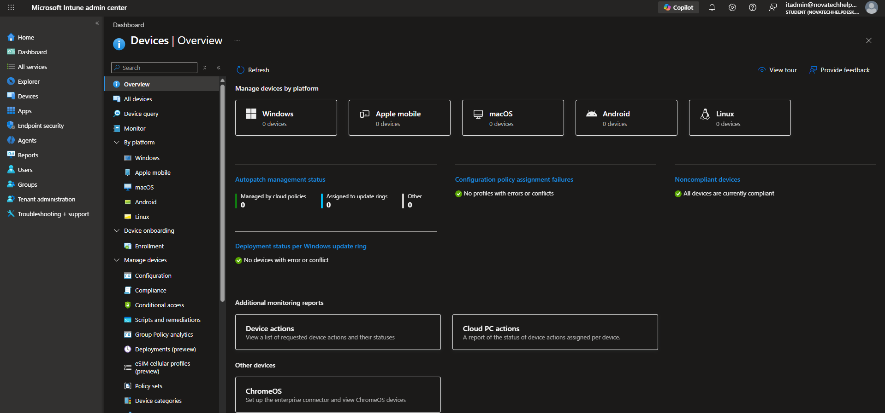

### Automatic Enrollment

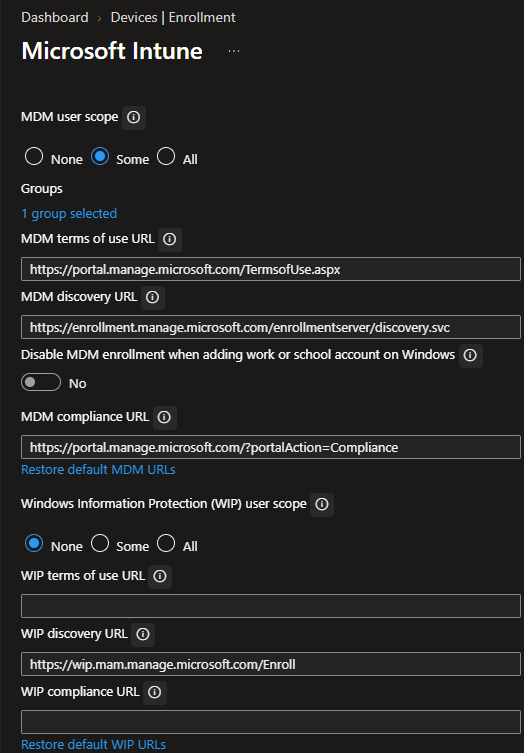

### Windows Virtual Machine

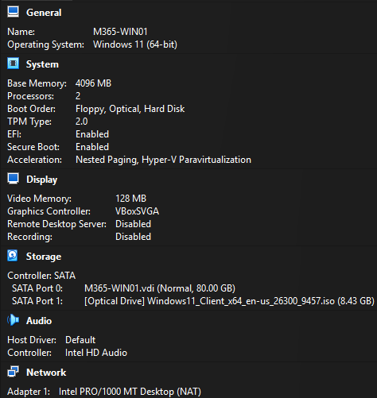

### Microsoft Entra Device Join

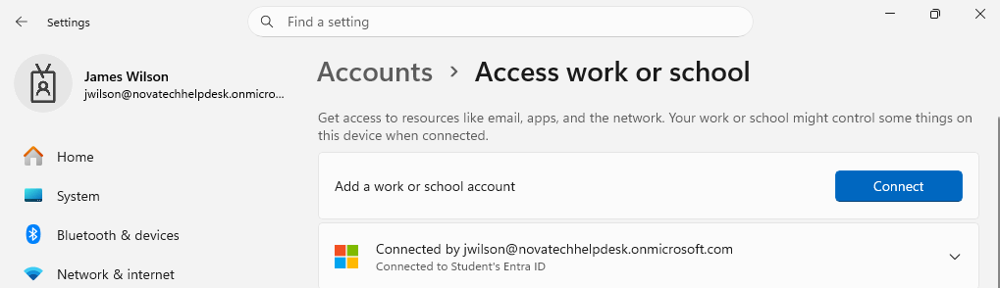

### Intune Device Enrollment

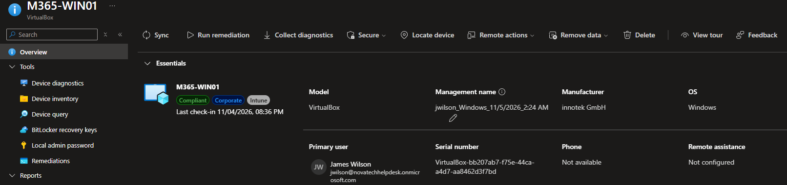

## 6. Device Compliance and Troubleshooting

Created a Windows device compliance policy to enforce fundamental endpoint security requirements.

**Policy:** `Windows 11 - Corporate Compliance`

Configured requirements for:
- Windows Firewall
- Antivirus
- Antispyware
- Microsoft Defender Antimalware
- Real-time protection
- Up-to-date Defender security intelligence

Initially encountered a noncompliant device status caused by outdated Microsoft Defender security intelligence.

Investigated the failed compliance setting, updated Defender security intelligence, synchronized the device, and verified that the workstation returned to a compliant state.

### Compliance Policy

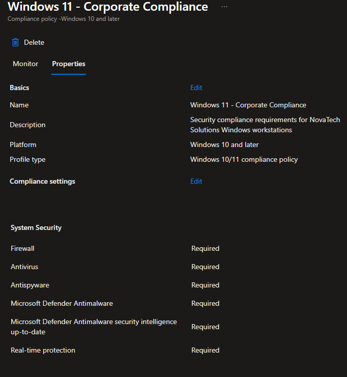

### Successful Compliance Verification

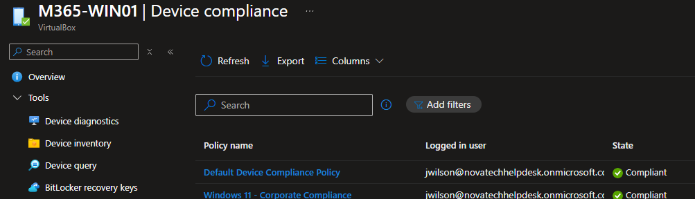

## 7. Help Desk Password Reset

Simulated an employee password reset request through the Microsoft 365 Admin Center.

Reset a fictional employee's password, configured a temporary password, and required a password change at the next sign-in.

### Password Reset

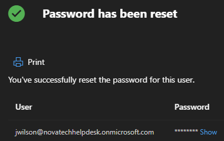

## 8. Employee Onboarding

Simulated onboarding a new employee, Kevin Anderson, in the Sales department.

Completed:
- Microsoft 365 user provisioning
- Department and job title configuration
- Business Premium license assignment
- Security group membership
- Standard user permission assignment

### Employee Onboarding

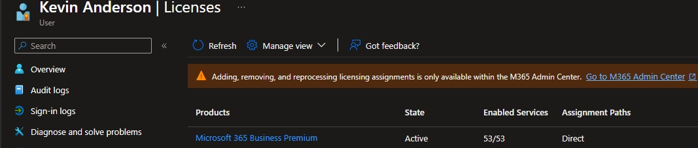

### Security Group Assignment

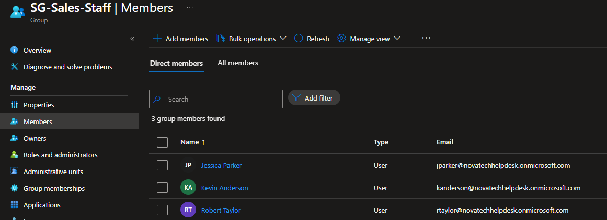

## 9. Employee Offboarding

Simulated offboarding the same fictional employee by:

1. Blocking Microsoft 365 sign-in.
2. Revoking active sign-in sessions.
3. Removing the employee from the Sales security group.
4. Removing the Microsoft 365 Business Premium license.

### Block User Sign-in

### Revoke Sessions

### Group Membership Removal

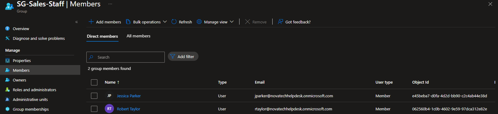

### License Removal

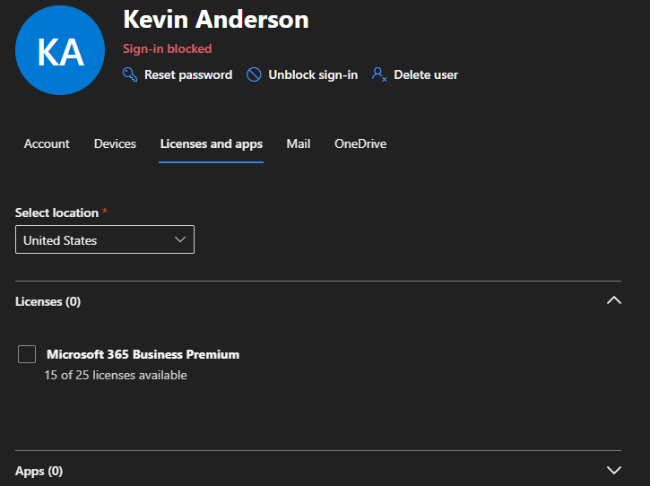

## Skills Demonstrated

- Microsoft 365 Administration
- Microsoft Entra ID Identity Management
- User Provisioning and License Management
- Security Group Administration
- Multi-Factor Authentication Configuration
- Conditional Access Policy Configuration
- Exchange Online Shared Mailbox Management
- Mailbox Delegation and Distribution Lists
- Microsoft Intune Device Enrollment
- Windows Endpoint Management
- Device Compliance Troubleshooting
- Microsoft Defender Security Intelligence Updates
- Employee Onboarding and Offboarding
- IT Help Desk Password Resets
- Technical Troubleshooting and Documentation

## Project Outcome

Successfully built a cloud-based Microsoft 365 IT administration lab using Microsoft Entra ID, Exchange Online, and Microsoft Intune.

Provisioned fictional employee accounts, configured identity and access management policies, managed shared mailboxes and distribution lists, enrolled a Windows 11 device, and resolved an actual Microsoft Intune compliance issue.

Completed hands-on employee onboarding, offboarding, and password reset procedures to demonstrate practical IT Help Desk and cloud administration skills.
